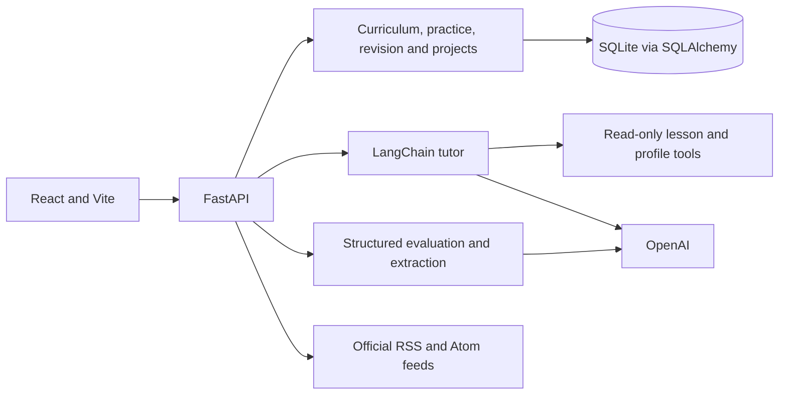

# Learning Coach

A local learning and interview preparation app connecting **teach → practice → feedback → revisit weak areas → advance**, built with React, FastAPI, SQLite, LangChain, and OpenAI.

## Current implementation

The active learning path is **Python for ML → MLOps → a guided ML project**. Other modules remain visible as **Coming soon**. Four levels are supported: Beginner, Foundational, Intermediate, and Advanced.

| Feature | Current behavior |
| --- | --- |
| Curriculum | Shared role/module/topic catalog, prerequisites, level-specific lessons, and module/topic preferences |
| Tutor | Persistent conversations, Markdown and math rendering, lesson context, and weak-area context |
| Practice | Continuous conceptual and applied practice inside submodules, separate role interview runs, and final summaries |
| Feedback | Rubric judgments with answer evidence, deterministic scores, retry protection, and local feedback reports |
| Question help | Discussion scoped to the question, submitted answer, and feedback; explanations do not change grades |
| Revision | Weak areas and due reviews derived from accepted practice and interview attempts |
| Job target | Extract and review pasted job requirements; map to available, planned, or unmapped curriculum topics |
| Guided project | Starter ZIP, six milestones, saved drafts, independent level workspaces, and assessed submissions |
| Tech updates | Manual official-source refresh, cached digest, source dates/links, optional AI summaries, and saved reading list |

As of **October 23, 2026**, the catalog contains **5 roles, 26 modules, and 271 reusable topics**, representing 300 supplied role-topic entries. Catalog presence does not mean a complete course exists.

There are **30 authored lessons and 102 questions**: 12 focused lessons/48 questions across the three active submodules at four levels; 4 Python variables/types lessons/16 questions; and 14 retained starter lessons/38 questions. Project milestone assessments are separate. Broader authored coverage and the role/level project ladder remain planned.

## Architecture



The LangChain `create_agent` tutor exposes only `get_lesson` and `get_learning_profile`. The server supplies lesson and weak-area context. Deterministic application services select assessed questions, calculate scores, persist results, and schedule revision. Separate bounded calls handle evaluation, question help, job extraction, and optional news summaries. There is no arbitrary learner-code execution, vector database, multiagent orchestration, or autonomous browser.

## Local setup

Requirements: Python 3.11+ and Node.js 22.12+. In PowerShell from the repository root:

```powershell
python -m venv .venv
.\.venv\Scripts\python -m pip install -r backend/requirements-dev.txt
if (-not (Test-Path backend/.env)) { Copy-Item backend/.env.example backend/.env }
```

Set `OPENAI_API_KEY` in `backend/.env`. The configured default `OPENAI_MODEL` is `gpt-4.1-mini`. Never commit your key.

```powershell
.\.venv\Scripts\python -m uvicorn app.main:app --app-dir backend --host 127.0.0.1 --port 8001
```

In another terminal:

```powershell
cd frontend
npm ci
npm run dev
```

Open Vite's printed URL, normally `http://127.0.0.1:5173`. Startup creates the local database and applies versioned content seeds. The development requirements include tests and ML-example dependencies; `backend/requirements.txt` contains app runtime dependencies. The older backend lock snapshot does not cover the complete ML example environment.

## User flow

1. Set role, level, study preferences, and timezone in **Learning profile**. Optionally paste and review a job description in **Job target**.
2. Open **Modules**, choose an available submodule, read its lesson, and ask the tutor questions.
3. Begin conceptual or applied practice within that submodule and continue without repeatedly selecting it. **Role interview** uses the role's available question bank.
4. Submit an answer, inspect rubric feedback, and open question-specific help for clarification. Feedback reports are saved locally.
5. Open **Your progress** to revisit weak areas and due reviews. End a run to see its summary.
6. Work through the **Guided project**, explicitly save drafts, and submit milestone evidence. Refresh **Tech updates** when desired.

Selected levels change content and difficulty; there is no automatic diagnostic or proficiency certification. Reviewed job requirements influence recommendations but do not generate a new interview question bank.

## Guided ML project

The [delivery-time starter](examples/ml_project/README.md) uses 120 deterministic synthetic rows split into 72 training, 24 validation, and 24 test rows. A scikit-learn pipeline combines imputation, scaling, and Ridge regression. Validation selects alpha; held-out test metrics compare the selected model against a mean baseline.

The saved pipeline has a manifest recording features, units, settings, metrics, package versions, and hashes. A separate FastAPI prediction service validates inputs and returns model versions. Optional local MLflow tracking requires a separate install.

The app tracks six milestones: data, baseline, training, evaluation, deployment, and monitoring. Each level has an independent workspace, version-checked draft saves, and immutable accepted submission snapshots. Milestone feedback contributes to applied-practice history. “Requirements met” refers to rubric evidence in submitted text; the app does not execute the learner's code. Synthetic metrics demonstrate the workflow, not production quality.

## Tech updates and API costs

Sources: Python Insider, scikit-learn releases, MLflow releases, PyTorch, Hugging Face Transformers releases, and OpenAI News. The digest considers dated entries from the last 30 days and curates up to five items. Refresh is manual, cached, and rate limited; there is no scheduled daily job or exhaustive news coverage.

| Action | OpenAI tokens |
| --- | --- |
| Browse lessons, history, projects, or cached updates | No |
| Tutor, answer evaluation, question help, job analysis | Yes |
| Refresh updates with AI off | No; official feed requests only |
| Refresh with AI on | Yes when a new summary is needed; bounded and reused for unchanged content |
| Automated tests and local ML training | No; tests inject model fixtures |

Failures preserve useful cached content and display source status. AI output must match source IDs and evidence; this does not guarantee semantic accuracy. Saved items retain their snapshot after the digest changes. See [tech update details](docs/tech-updates.md).

## Persistence and feedback

SQLite stores the local learner, conversations, runs, attempts, preferences, reviewed job targets, project drafts/submissions, feedback flags, digests, and bookmarks. Catalog definitions include JSON payloads. Weak areas and review schedules are derived from accepted attempts rather than mutable mastery tables.

Attempts are saved before evaluation. Retries retain the answer and ID, and accepted feedback is reused. The evaluator must cover all rubric criteria and supply matching answer quotations. Judgments are `met`, `partial`, `not_met`, or `insufficient_evidence`; deterministic scoring yields no score for insufficient evidence.

Review groups separate skill, mode, module, submodule, and level. Current intervals are 1 day below score 50, 2 days for partial performance, and 4 days for fully correct performance. A later correct result on a distinct question after the required gap can extend this to 8 days. These are learning heuristics, not validated outcome measures.

This is a **single-learner local MVP**. Authentication, formal schema migrations, production deployment, and cross-worker concurrency remain future work. AI features send relevant learner input and context to the configured provider. Environment files, databases/backups, generated model artifacts, and document previews are ignored by Git.

## Verification

```powershell
.\.venv\Scripts\python -m pytest backend/tests -q
node --test frontend/src/CoachMessage.test.js
cd frontend
npm run build
```

Latest completed checks: **91 backend tests passed** and the frontend production build passed, with a nonblocking Vite chunk-size warning. Coverage includes persistence, retry/evidence validation, curriculum, project workflows, example prediction parity, and feed/cache/error handling.

The [feedback evaluation harness](evals/README.md) uses 20 synthetic development cases repeated twice, giving 80 criterion judgments. Rubric v2 matched 69/80 expected judgments; v3 matched 80/80 on the same development set. These are development regression results, not held-out accuracy, expert validation, or proven learning gains. Live evaluation runs consume OpenAI tokens.

## Portfolio status and next steps

The working MVP demonstrates a tool-assisted tutor, structured assessment validation, durable learning state, evidence-based revision rules, a reproducible small ML example, and source-aware ingestion. Resume descriptions should state those implemented behaviors and label synthetic development results accurately.

Next priorities: an end-to-end demo and real learner feedback, independent held-out assessment evaluation, and deeper content in the active ML path. Deployment hardening and broader courses follow as needed.

## Documentation

- [Architecture and implementation document](docs/Learning_Agent_Architecture.docx)
- [Shared curriculum and migration notes](docs/shared-curriculum.md)
- [Tech update behavior](docs/tech-updates.md)
- [ML project starter](examples/ml_project/README.md)
- [Feedback evaluation methodology](evals/README.md)

`docs/build_design.py` generates the Word document using `python-docx`. Update that source before regenerating the document, then render and visually verify it.
